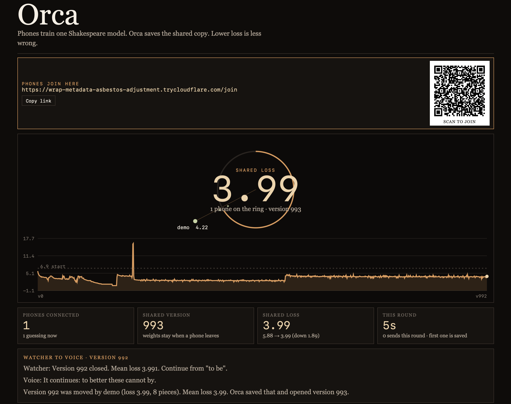
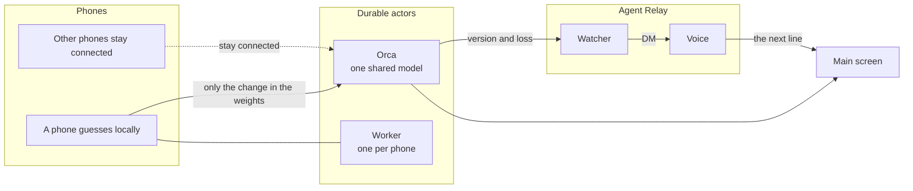
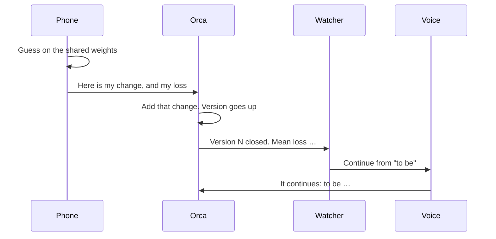
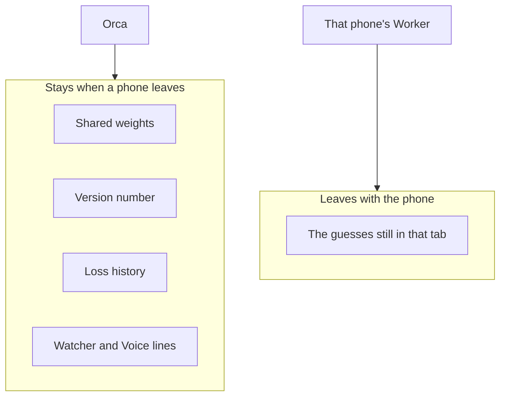
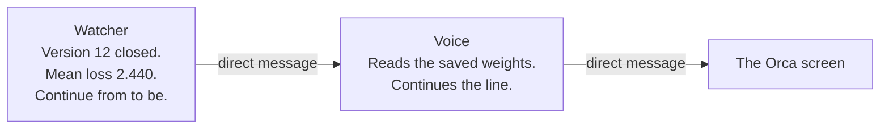

# Séance

Phones train one tiny Shakespeare model. **Orca** keeps the shared weights. When a round closes, two agents talk: the **Watcher** reports the loss, and the **Voice** continues the line from “to be”.

Marthala Sai Kavya · Haunted Hacks

This is the screen. Phones join with the QR. The ring is the shared loss. The chart is every version so far. Under that, the Watcher tells the Voice the loss, and the Voice answers.



The two-slide intro is at `/intro`.

## The picture



A phone does the guessing. Orca does the remembering. The Watcher and the Voice only talk after a save.

## One round

A round is about 12 seconds. The first phone to send is the one Orca saves.



Lower loss means the model is less wrong. The number on the screen is the mean loss of the save that just closed.

## Durable actors

The weights used to live in a file on one machine. A phone could leave and take the only copy with it. A durable actor fixes that. The actor’s fields are saved before the call returns, so a restart or a dropped phone does not wipe the model.

We use two actor classes, both from Terse:

| Actor | How many | What it is for |
| --- | --- | --- |
| **Orca** | One, id `orca` | The shared weights, the version, the round clock, the loss history, and the lines the agents said |
| **Worker** | One per phone | That phone’s own progress. It does not hold the shared model |



Orca is the only place the averaged model lives. A phone sends the **change** in the weights, not a brand new model. Orca adds that change onto the copy it already has:

```text
new weights  =  old weights  +  this phone's change
```

The full change is large, so the phone posts it to `/publish`. The live socket is for small news: who is here, the clock, and the loss.

Code: `seance/hall/src/actors.ts`.

## Agent Relay

The Watcher and the Voice are two agents. They do not share a prompt. They send each other a message.



What each one does:

- **Watcher** — after Orca closes a version, it tells the Voice the version and the mean loss, and asks it to continue from “to be”.
- **Voice** — reads the weights Orca just saved, samples the next line, and sends that line back.

The conversation is one Agent Relay flow, `seance/relay/flows/round-closed.flow.ts`. It runs once per closed version. It does not train, and it does not change the version. The two messages show on the main screen under **Watcher to Voice**.

On the screen above, that exchange is already filled in:

```text
Watcher    Version 992 closed. Mean loss 3.991. Continue from "to be".
Voice      It continues: to better these cannot by.
```

Version 992 was moved by the phone on the ring. Orca saved that and opened version 993. Loss started near 6.9 and is now 3.99.

## What you see

```text
Main screen  /        the picture above
Join         /join    the QR on that screen
Intro        /intro   two slides. Right arrow moves forward
Frames       /frames  phone-sized copies for a recording. Not linked from Orca
```

## Run it

```bash
npm install
cd seance/hall && terse actor dev
```

In another terminal, from the repo root:

```bash
deno run --allow-net --allow-read --allow-write --allow-env --allow-run seance/server.js
```

And the phone that keeps the round moving:

```bash
deno run --config seance/deno.json --allow-net --allow-read --allow-write seance/demo-phone.js
```

The page is at `http://127.0.0.1:43131/`.

`terse actor dev` serves Orca and Worker at `http://127.0.0.1:7100`. `terse deploy` from `seance/hall` publishes those same actors. Keep `TERSE_ACTOR_URL` and `TERSE_API_KEY` in the server environment, not in the page and not in git.

## Where to look

| Piece | File |
| --- | --- |
| Orca and Worker | `seance/hall/src/actors.ts` |
| The screen, the join page, and the voice trigger | `seance/server.js` |
| Watcher to Voice flow | `seance/relay/flows/round-closed.flow.ts` |
| The line the Voice reads | `seance/infer.js` |
| The model | `gpt.js`, `train.js`, `bpe.js` |
